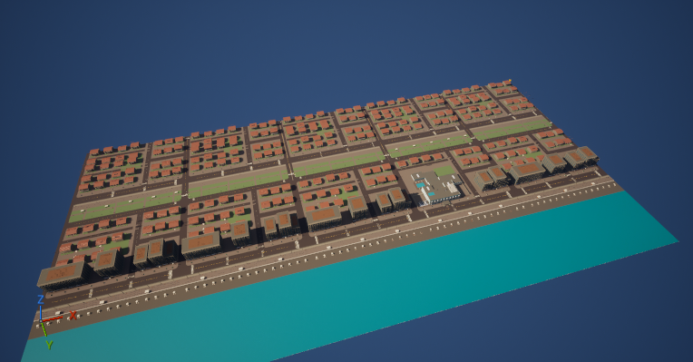
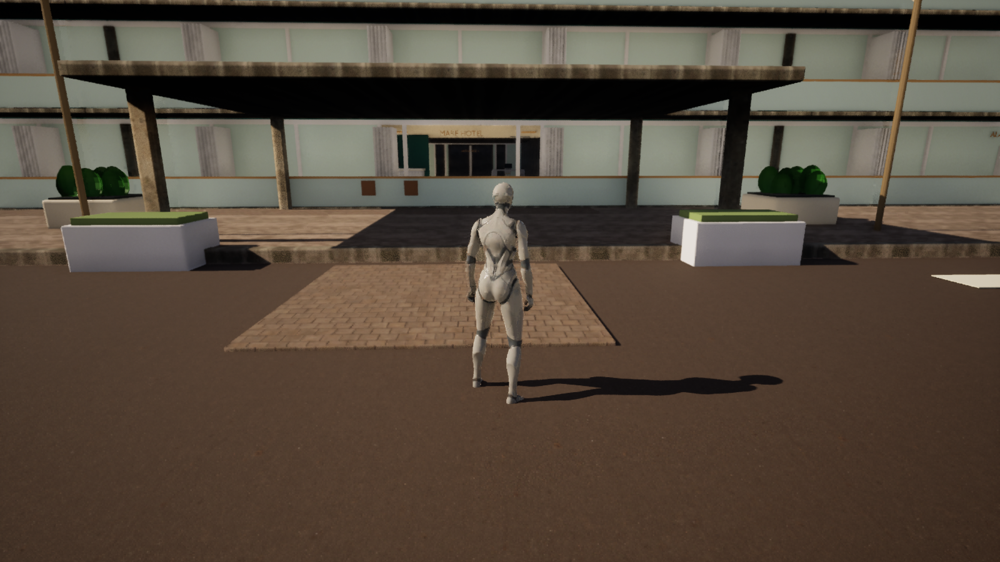

# Project Resort — desenvolvimento Unreal

**Checkpoint ativo: Unreal Engine 5.8.3, mapa costeiro de 1.000 × 500 m.**

Abra `UnrealProject/ProjectResortUE.uproject`. Faça `git lfs pull` após clonar esta branch para baixar modelos e assets. O nível `/Game/Resort/Maps/Resort_HalfWest` abre automaticamente.

[Como abrir, verificações e pendências](docs/UNREAL_COAST500_CHECKPOINT.md) · [Recorte do mapa](UnrealProject/COAST500.md)





O checkpoint inclui a base Blender e os assets locais da Unreal. O gameplay de evolução em 20 etapas ainda precisa ser portado; não há FPS ou build Unreal validado.

## Histórico Unity — etapa anterior

As informações abaixo descrevem o checkpoint histórico de 300 m, anterior à migração para Unreal e ao recorte atual.

# Project Resort — 300 × 300 m

Projeto Unity independente de um recorte real de Copacabana, com edifícios, praia, calçadão, ruas e céu tropical com nuvens. Escala preservada: **1 unidade = 1 metro**. Toda a geometria distribuída foi recortada no quadro GIS; não foi reduzida por escala.

Abra `UnityProject` no **Unity 6000.6.2f1** e a cena `Assets/Scenes/ProjectResort_300m.unity`. URP **17.6.0**, instalado pelos manifestos de Packages. Todos os meshes, materiais, texturas e shaders da cena estão neste repositório. Não são necessárias outras cópias de projetos.

Validação local executada no Unity com **Direct3D11 / RTX 4060 Ti**: 380 malhas, 370 renderizadores ativos, quatro capturas reais de 1600 × 900, zero referência a assets legados e 18/18 consultas de solo com colisão. O projeto é uma base de paisagem em desenvolvimento. **A arte ainda não foi aprovada; Player, PlayMode, NPCs, saves e FPS não foram testados.**

Para verificar os arquivos e as evidências:

```powershell
python tools/test_standalone.py
```

Para repetir a importação e a captura nativas:

```powershell
powershell -NoProfile -ExecutionPolicy Bypass -File tools/run_unity_qa.ps1
```

O script aceita `-Editor`, `-Project` e `-Output`. Requer Unity instalado e licenciado e uma GPU disponível. O CI executa os testes de integridade portáteis; não substitui o teste nativo do Editor.

Confira [QA e limitações](docs/QA_STANDALONE.md), [direitos e atribuições](docs/ASSET_RIGHTS.md), [dependências anteriores](docs/DEPENDENCIES_BEFORE.md) e o [manifesto de exclusão para o supervisor](docs/DELETE_LEGACY_MANIFEST.md). Não excluir fontes antes da confirmação de independência na nuvem.


© OpenStreetMap contributors — ODbL 1.0. Arte procedural original produzida para Project Resort; veja o registro de direitos.
